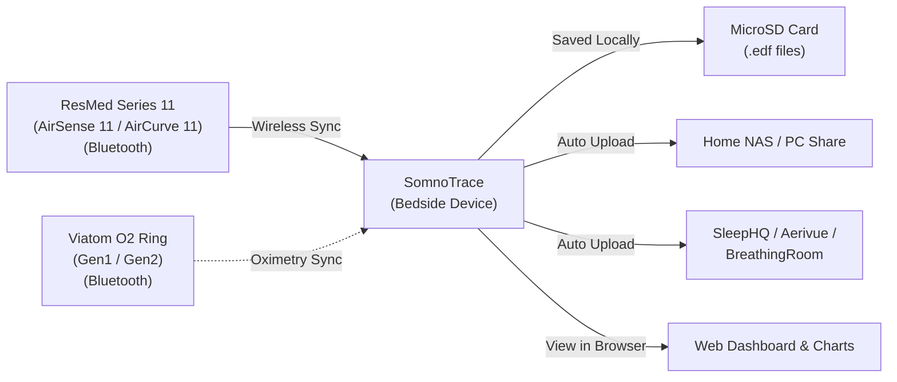

  

> A plug-and-play wireless bridge that pulls CPAP therapy and pulse oximetry data over Bluetooth, automatically saves standard European Data Format (EDF) files, and uploads them to your home network (NAS/SMB), [SleepHQ](https://sleephq.com), [Aerivue](https://aerivue.app), or [BreathingRoom](https://breathingroom.io) — **no SD card swapping or Wi-Fi SD cards required**.

Created and architected by **Ilya Kruchinin** ([@ilyakruchinin](https://github.com/ilyakruchinin)).  
Spiritual successor to [CPAP-AutoSync](https://github.com/ilyakruchinin/CPAP-AutoSync), transitioning from software-only sync to a dedicated, standalone hardware device.

---

## Highlights

- 📡 **Wireless therapy data over BLE — no SD card at all:** Pulls detailed sleep therapy data directly from ResMed Series 11 machines (AirSense 11 / AirCurve 11) over Bluetooth — no SD card needed in the machine, no Wi-Fi SD adapters (such as EZShare), no daily card swapping.
- ⏱️ **Zero clock drift:** The AirSense 11's clock drifts by minutes, misaligning CPAP and oximeter graphs in OSCAR and SleepHQ. SomnoTrace continuously aligns therapy records to exact internet time (NTP) for sample-accurate sync with your oximetry data.
- 🚨 **Therapy interruption & high-leak alerts:** If your mask slips off, the leak rate stays high, or therapy stops unexpectedly at night, SomnoTrace sends a push notification to your phone, smartwatch, or smart bed shaker via [ntfy](https://ntfy.sh) — with an optional escalating buzzer alarm on the device speaker.
- ⚡ **BLE → Wi-Fi bridge & smart home:** Query machine settings or start/stop therapy remotely, and build [Home Assistant automations](docs/automations.md) (e.g. turn off bedroom lights when therapy starts). Built-in MQTT publishes live telemetry with Home Assistant Auto-Discovery.
- 🧠 **On-device sleep staging (official builds):** SomnoStage classifies every 30-second epoch into Wake, REM, Light, or Deep sleep locally on the ESP32-S3 — no cloud, no subscription. *(Proprietary model bundled in official release builds only; source builds compile a functional stub — see [somnostage](https://github.com/ilyakruchinin/somnostage).)*
- 📤 **Automatic uploads:** Completed sessions are sent to your local computer / NAS share (SMB), [SleepHQ](https://sleephq.com), [Aerivue](https://aerivue.app), and [BreathingRoom](https://breathingroom.io) as soon as therapy stops.
- 🖥️ **Color screen & web dashboard:** Live breathing graphs, Wi-Fi status, battery level, and clock on the bedside LCD; interactive sleep charts and device settings from any browser at `http://somnotrace.local`.
- 🏕️ **Camping mode:** Records therapy with no Wi-Fi or internet at all — just the AirSense 11 nearby. See the [Camping Mode guide](docs/camping.md).

---

## Hardware

SomnoTrace runs on a compact, affordable, all-in-one development board:

- **Hardware Board:** **[Waveshare ESP32-S3-Touch-LCD-1.54](https://www.waveshare.com/esp32-s3-lcd-1.54.htm?sku=33869)**  
  *(The **touch variant with battery** is strongly recommended for portable bedside use).*
- **Display:** 1.54" round-corner color screen with touch control.
- **Storage:** MicroSD card slot for saving high-resolution sleep data and EDF files.
- **Audio:** Onboard speaker for therapy alerts and status tones.
- **Power:** USB Type-C or internal rechargeable battery with smart charging.

**Additional accessories required:**
- micro-SDHC card (8 GB minimum, 16 GB+ recommended; U1 or U3 speed class)
  - goes inside the WaveShare board for internal file storage
- USB-C data cable (for initial flashing and charging)
- USB-C charger (for overnight power)

> ⚡ **Power note:** SomnoTrace is designed to run on **stable USB-C power** overnight — the battery is outage protection, not a primary power source. See the [Battery & Power Guidelines](docs/battery.md) (including the `--% ⚡` calibration fix).

---

## Supported Devices

- **CPAP Machines:**
  - ResMed AirSense 11 (AutoSet / Elite)
  - ResMed AirCurve 11 (VAuto / ASV)
- **Pulse Oximeters:**
  - **O2 Ring S (Gen2)** — Viatom model PO2B (S8-AW). Also sold as: 
    - Wellue O2Ring S
    - SleepHQ O2 Ring Pro.
  - **O2 Ring (Gen1)** — Viatom model PO2 (S9). Also sold as:
    - Wellue O2Ring
    - LOOKEE O2Ring
    - SleepHQ O2 Ring (non-Pro)
- **Upload Destinations:**
  - Local network share (SMB — Windows, macOS, Linux/Samba)
  - [SleepHQ](https://sleephq.com)
  - [Aerivue](https://aerivue.app)
  - [BreathingRoom](https://breathingroom.io)

 

<b>🔘 Button Controls</b>

The board has three physical buttons on the side. Here's what each one does:

| Button | Action | What It Does |
|---|---|---|
| **BOOT** (left) | Hold 5 seconds | Enters Wi-Fi setup mode (AP hotspot) for initial configuration or network changes. |
| **POWER** (middle) | Single click | Toggles the LCD backlight on or off on demand (or dismisses a temporary wake). Works across all display modes. |
| **POWER** (middle) | Hold 5 seconds | Powers off the device. |
| **POWER** (middle) | Hold 2 seconds | Powers on the device (when off). |
| **PLUS** (right) | Single click | Acknowledges and silences an interrupted therapy or high-leak alert (if enabled). |
| **PLUS** (right) | Double click | Starts or stops therapy on the AirSense 11 (toggle — same as pressing the machine's own button). |

---

## How It Works

1. **Pair once** — [connect SomnoTrace to your ResMed Series 11 machine](docs/pairing.md) and O2 Ring over Bluetooth in seconds.
2. **Sleep normally** — SomnoTrace records airflow, pressure, leak, and respiratory events in real time, then writes standard EDF files and uploads them to your configured destinations when therapy stops.
3. **Review anywhere** — open `http://somnotrace.local` for interactive charts, or find your night in SleepHQ, Aerivue, or BreathingRoom.

---

## Web Dashboard

Access the built-in web portal from any device on your Wi-Fi network without installing any apps:

  

- **Interactive Sleep Graphs:** High-resolution zoomable graphs for Breathing Flow, Mask Pressure, Leak Rate, Respiratory Rate, and Flow Limitation.
- **Sleep Stage Hypnogram (Official Builds):** Visualizes your night's sleep architecture (Wake, REM, Light, Deep) with connected stage ribbons, transition analytics, and per-stage duration & percentage totals.
- **Clinical Sleep Metrics:** AHI, Obstructive Apnea (OA), Central Apnea (CA), Hypopnea (H), RERA, and 95th percentile pressure & leak stats.
- **One-Click Wi-Fi & Device Setup:** Configure Wi-Fi networks, upload destinations, screen brightness, and alert settings with simple toggles.
- **Over-the-Air (OTA) Updates:** Update firmware directly through the web interface with a single click.

---

## Installation

### 1-Click Web Installer at somnotrace.com (Recommended — Under 1 Minute)

No software, drivers, command line, or file downloads required. Install SomnoTrace directly from your browser (**Google Chrome**, **Microsoft Edge**, **Brave**, or **Opera**):

1. Plug your Waveshare board into your computer with a **USB-C data cable**.
2. Visit **[somnotrace.com](https://somnotrace.com)**.
3. It takes literally **3 clicks**:
   - Click **Install SomnoTrace**
   - Select **USB JTAG/serial debug unit** in the browser popup
   - Click **Connect**

That's it! The web flasher automatically fetches the latest stable release, switches the board into download mode, flashes the firmware, and reboots the device into SomnoTrace.

Once rebooted, connect your phone or computer to the **`SomnoTrace-Setup`** Wi-Fi network to complete Wi-Fi setup.

👉 **[Detailed Web Flashing & Setup Guide](docs/flashing.md)**

*Developers: Docker-based build & flash commands are documented in [`AGENTS.md`](AGENTS.md).*

---

## Documentation

- 📖 **[Web Flashing Guide](docs/flashing.md)** — Easy browser-based installation guide for everyone.
- 🔗 **[AirSense 11 Pairing Guide](docs/pairing.md)** — Pair your ResMed CPAP with SomnoTrace over Bluetooth.
- 🔋 **[Battery & Power Guidelines](docs/battery.md)** — Why USB-C power is recommended, and the `--% ⚡` calibration fix.
- 🏕️ **[Camping Mode](docs/camping.md)** — Recording offline with no Wi-Fi or internet.
- 🕛 **[Cross-Noon Sessions](docs/cross-noon.md)** — Why midday therapy stays one continuous session.
- ⚡ **[ResMed BLE RPC Bridge Guide](docs/rpc-bridge.md)** — Send direct queries and commands (`curl` examples) to the AirSense 11 over Wi-Fi.
- 🏠 **[Smart Home & Home Assistant Guide](docs/automations.md)** — Set up bedtime automations, compliance tracking, and mask-off alerts.
- 🛠️ **[Hardware Reference](docs/hardware/README.md)** — Pinouts, schematics, and hardware architecture.

<b>📁 Accessing Files via FTP</b>

SomnoTrace includes a built-in FTP server for downloading EDF and session files directly from the MicroSD card over Wi-Fi — no need to physically remove the card. FTP is optional and can be enabled or disabled from the web dashboard. By default, it allows anonymous (no password) access on your local network, but you can configure a username and password if you prefer.

Connect with any FTP client (e.g., FileZilla) to `ftp://somnotrace.local`.

> **FileZilla tip:** If you experience connection errors, go to **Site Manager → Edit → Transfer Settings** and set **"Limit number of simultaneous connections"** to **1**. The ESP32-S3 FTP server processes one connection at a time.

---

## Features

**Capture & Files**
- Secure Bluetooth sync with ResMed AirSense 11 and AirCurve 11 — live stream recording and summary data retrieval
- Downloads stored oximetry recordings from Viatom O2 Ring (Gen1 & Gen2) over Bluetooth
- Standard `STR.edf`, `BRP.edf`, `PLD.edf`, `EVE.edf`, and `CSL.edf` files — compatible with OSCAR and SleepHQ
- Sub-second NTP clock sync eliminates AirSense 11 clock drift for pulse oximeter alignment
- Therapy spanning midday is recorded as one continuous session ([details](docs/cross-noon.md))
- SomnoStage on-device sleep staging (Wake / REM / Light / Deep) — official release builds only

**Upload Destinations**
- SMB / NAS network share — Windows, macOS, and Linux/Samba folders
- [SleepHQ](https://sleephq.com) — direct HTTPS upload with fast retry handling
- [Aerivue](https://aerivue.app) — CPAP sessions and oximetry recordings via upload key
- [BreathingRoom](https://breathingroom.io) — CPAP sessions and oximetry recordings via personal access token (oximetry requires a BreathingRoom Premium account)

**Alerts & Smart Home**
- Therapy interruption alarm — push notifications via [ntfy](https://ntfy.sh) (phone/smartwatch/bed shaker) and an escalating audio buzzer
- High-leak alert — rolling 2-minute leak average with a configurable threshold, same notification path
- MQTT client publishes therapy events, alert state, BLE status, and device telemetry; Home Assistant Auto-Discovery provisions all entities automatically
- Bidirectional MQTT commands for remote therapy start/stop and alarm acknowledgement
- BLE → Wi-Fi RPC bridge — local HTTP endpoint for machine queries and smart home control

**Interfaces**
- Web dashboard — interactive sleep charts, AHI breakdown, status telemetry, easy setup
- 1.54" color LCD — live flow graph, Wi-Fi/battery/clock status
- Built-in FTP server — download EDF and session files directly from the MicroSD card

---

## Contributing

Contributions and ideas are always welcome! Please review [`CONTRIBUTING.md`](CONTRIBUTING.md) before submitting pull requests.

- **Contributor License Agreement:** A [CLA](CLA/individual-cla.md) is required before PRs can be merged (automated on your first PR).
- **Clean-Room Policy:** SomnoTrace is a clean-room implementation based on open protocol documentation. Do not copy third-party source code into this repository.

---

## Acknowledgements

SomnoTrace protocol understanding and interoperability research was informed by the following open-source projects (clean-room implemented — see [`THIRD-PARTY-NOTICES.md`](THIRD-PARTY-NOTICES.md)):

- [airbreak-plus](https://github.com/m-kozlowski/airbreak-plus) — ResMed AirSense 11 BLE protocol reference
- [o2ring-s-protocol](https://github.com/nglessner/o2ring-s-protocol) — Wellue / O2 Ring S (Gen2) BLE protocol reference
- [farolone/wellue-o2ring-protocol](https://github.com/farolone/wellue-o2ring-protocol) — O2 Ring (Gen1) BLE protocol reference
- [OSCAR](https://gitlab.com/pholy/OSCAR-code) — European Data Format (EDF) interoperability and statistical metric reference
- [libsmb2](https://github.com/sahlberg/libsmb2) — SMB2/SMB3 client library (LGPL-2.1)
- [esp-idf-ftpServer](https://github.com/nopnop2002/esp-idf-ftpServer) — Embedded FTP server (MIT)
- [uPlot](https://github.com/leeoniya/uPlot) — Fast time-series charting library (MIT)
- [Roboto Font](https://github.com/google/fonts/tree/main/ofl/roboto) — UI typeface (SIL Open Font License 1.1)

---

## License

SomnoTrace is free software released under the **GNU General Public License v3.0** with an author attribution requirement under **GPLv3 Section 7(b)**.

- Full license text: [`LICENSE`](LICENSE)
- Copyright & Section 7(b) Attribution Terms: [`NOTICE`](NOTICE)

Any redistributed or derivative works must remain licensed under GPLv3 and preserve the author attribution notice:  
> *"Based on SomnoTrace, originally created by Ilya Kruchinin (https://github.com/ilyakruchinin)."*

**Optional SomnoStage Model Component:**  
Official release builds (published on GitHub Releases and flashed via the 1-click web installer at [somnotrace.com](https://somnotrace.com)) bundle the **SomnoStage** sleep-staging model under a separate, closed-source proprietary license (free for personal use on official builds). The model is not covered by GPLv3 and its weights are not stored in this repository. Compiling SomnoTrace from source automatically builds a functional stub without the proprietary model. Full model details, PSG benchmark accuracy, and licensing terms are documented at [ilyakruchinin/somnostage](https://github.com/ilyakruchinin/somnostage).

---

## Medical Disclaimer

SomnoTrace is an independent open-source project and is **not affiliated with, endorsed by, or associated with** ResMed, Wellue / Viatom, SleepHQ, Aerivue, or BreathingRoom. It is intended strictly for personal data portability and interoperability research. SomnoTrace is **not a medical device** and must not be used for clinical diagnosis, treatment decisions, or life-critical monitoring. Use entirely at your own risk.

